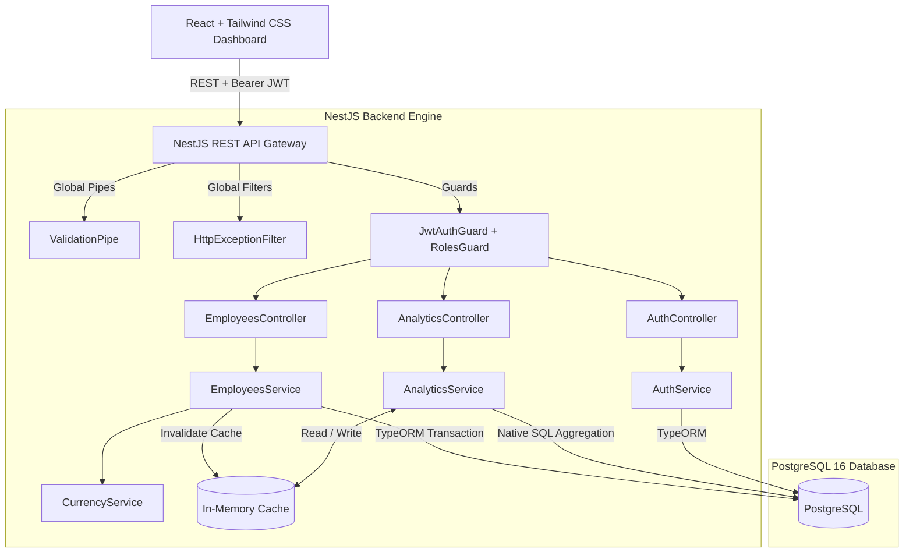

# System Architecture & Architecture Decision Records (ADRs)

## 1. High-Level Architecture

---

## 2. Architecture Decision Records (ADRs)

### ADR-01: Monetary Precision via Integer Minor Units
* **Status:** Accepted & Implemented
* **Context:** ACME manages global salaries across 5 currencies. JavaScript `Number` uses IEEE-754 double-precision floating-point arithmetic, which introduces non-deterministic rounding errors (e.g., `0.1 + 0.2 !== 0.3`).
* **Decision:** All monetary amounts are stored as PostgreSQL `BIGINT` in the smallest indivisible currency subunit (cents, paise, pence).
* **Consequences:**
  * Zero floating-point rounding errors in database storage or server-side calculations.
  * Formatted to major decimal units exclusively at the presentation layer using `Intl.NumberFormat`.
  * Safe integer precision up to 9 quadrillion cents (~$90 trillion USD).

### ADR-02: Deterministic Baseline FX Rate Normalization at Write/Seed Time
* **Status:** Accepted & Implemented
* **Context:** ACME requires real-time organizational payroll analytics across disparate local currencies (`USD`, `INR`, `GBP`, `EUR`, `SGD`). Calling external live FX APIs introduces network latency, rate limit failures, external costs, and analytical drift.
* **Decision:** We implement a deterministic, versioned baseline FX conversion service (`CurrencyService`). Employees store both `base_salary_minor` (local currency) and `base_salary_usd_minor` (computed at write/seed time).
* **Consequences:**
  * Aggregation queries (`SUM()`, `AVG()`, `MIN()`, `MAX()`) run natively in PostgreSQL SQL in `< 20ms` without runtime currency conversion loops.
  * Deterministic test suites run 100% offline without network mocks.

### ADR-03: 10,000-Row Query Performance & Caching Strategy
* **Status:** Accepted & Implemented
* **Context:** The system must support instant filtering, searching, and org-wide analytics over 10,000 global employee records under 100ms.
* **Decision:**
  1. Composite B-tree indexes placed on `(country, department, level)` and `(base_salary_usd_minor)`.
  2. Strict server-side pagination with maximum page size capped at 100 records (`limit <= 100`).
  3. Analytics endpoints (`/api/analytics/*`) cached with 60-second TTL in NestJS `CacheModule`.
  4. Cache automatically invalidated upon any salary mutation.
* **Consequences:**
  * High concurrency reads on analytics execute in `< 5ms` from cache.
  * Filtered table queries execute in `< 50ms` using composite indexes.

### ADR-04: Transactional Audit Trail for Salary Revisions
* **Status:** Accepted & Implemented
* **Context:** Compensation adjustments must be legally auditable, recording effective dates, business justifications, and authorizing parties.
* **Decision:** Every salary update executes atomically inside a TypeORM database transaction (`DataSource.transaction`). The transaction updates `employees` and inserts an immutable audit entry into `salary_history`.
* **Consequences:**
  * Partial updates or orphaned records are impossible; database rollback guarantees financial integrity.
  * Audit records cannot be mutated or deleted by application endpoints.

### ADR-05: Role-Based Access Control (RBAC)
* **Status:** Accepted & Implemented
* **Context:** Compensation data is sensitive. HR Administrators need write permissions; read-only stakeholders (Finance, Viewers) must be prohibited from tampering with compensation.
* **Decision:** Two distinct roles (`HR_ADMIN` and `HR_VIEWER`) enforced via declarative NestJS `@Roles(...)` metadata and `RolesGuard`.
* **Consequences:**
  * `HR_ADMIN`: Full access to query directory, analytics, revise salaries, onboard new employees, and offboard employees.
  * `HR_VIEWER`: Read-only access to directory, analytics, and audit history. Attempted salary mutations or lifecycle changes result in an immediate `403 Forbidden`.
  * Frontend reflects RBAC dynamically by disabling edit controls and providing one-click demo login buttons.

### ADR-06: Employee Lifecycle Management (Onboarding & Soft-Delete Offboarding)
* **Status:** Accepted & Proposed for Implementation
* **Context:** In addition to compensation revision, HR Administrators require mechanisms to onboard new staff and offboard departed personnel. Hard-deleting employees from PostgreSQL destroys foreign key integrity with `salary_history` and violates financial and tax audit compliance requirements.
* **Decision:**
  1. **Onboarding (`POST /api/employees`):** Restricted to `HR_ADMIN`. Accepts employee profile and compensation details. Atomically generates the next unique `employeeId` (`ACM-XXXXX`), computes normalized `baseSalaryUsdMinor` via `CurrencyService`, sets `isActive: true`, and inserts an initial `SalaryHistory` record with reason *"Initial employment offer"*.
  2. **Offboarding (`PATCH /api/employees/:id/deactivate`):** Restricted to `HR_ADMIN`. Soft-deletes the employee by setting `isActive = false`. Hard deletion (`DELETE`) is explicitly forbidden.
  3. **Directory & Analytics Filtering:** All active directory searches and analytics aggregations enforce `isActive = true`.
  4. **Cache Invalidation:** Both onboarding and offboarding invalidate the analytics cache (`AnalyticsService.invalidateCache()`), ensuring headcount and total payroll figures update immediately.
* **Consequences:**
  * Preserves 100% of historical audit trails and historical compensation data.
  * Deactivated employees vanish from active directory views and no longer burden payroll aggregation queries.
  * Re-activation remains technically feasible without data loss.
